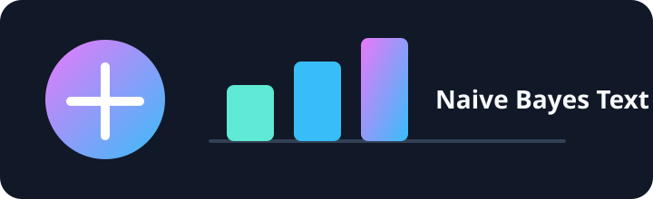

   

## 🔎 Overview
Learn Multinomial Naive Bayes with a small built-in support-versus-billing dataset, Laplace smoothing, and transparent score breakdowns.

## ✨ Features
- 🧠 Trains a Multinomial Naive Bayes model from a visible toy dataset
- 📝 Classifies text entered locally in the browser
- 🔬 Shows class priors, token counts, and per-token log contributions
- 📚 Explains that the tiny sample is educational, not a production classifier

## 🎬 Demo
No hosted demo is published. Run the project locally using the Quick Start command below.

## 🚀 Quick Start
    npm install && npm start

Open http://127.0.0.1:4175 in your browser.

## 🧰 Tech Stack
- Node.js 18+
- Vanilla JavaScript
- Multinomial Naive Bayes with Laplace smoothing

## 🗂️ Folder Structure
    server.js              Local static server
    public/index.html      Classifier controls and explanation panels
    public/app.js          Tokenization, training, and scoring
    public/style.css       Responsive interface

## 🛣️ Roadmap
- [ ] Allow users to edit and add labeled training documents
- [ ] Add a downloadable JSON model summary

## 🤝 Contributing
Issues and pull requests are welcome. Keep changes focused, document behavior, and add a small reproducible example for new features.

## 📄 License
Released under the MIT License. See LICENSE.

